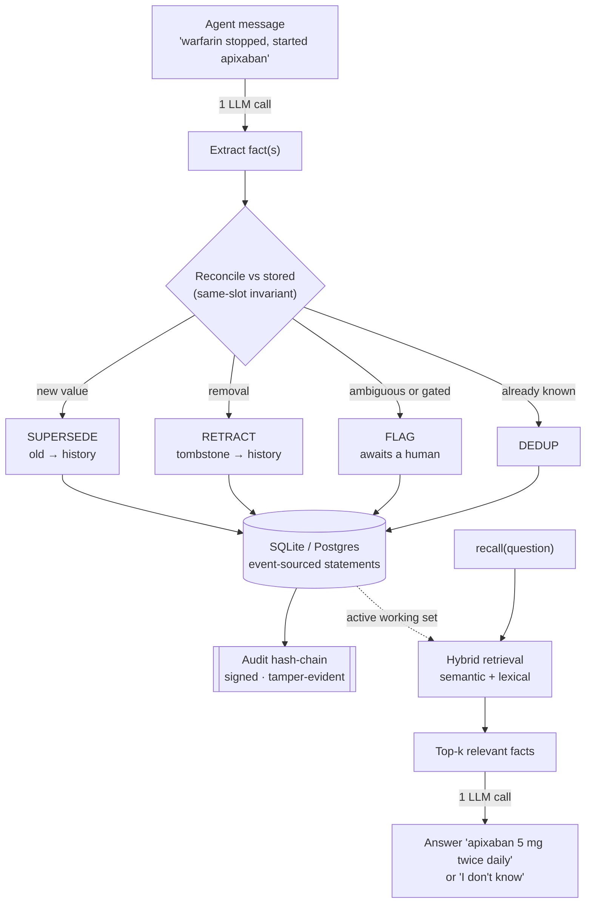

<div align="center">

# Vayl

<h3>The reconciling memory layer for AI agents</h3>

<samp>when a fact changes, your agent stops using the old one</samp>

<br>

[](https://pypi.org/project/vayl-mcp/)
[](https://scorecard.dev/viewer/?uri=github.com/ac12644/vayl)


[](https://vayl.gitbook.io/vayl-docs)

[**Quickstart**](#quickstart)&nbsp; ·&nbsp; [Why Vayl](#why-vayl)&nbsp; ·&nbsp; [Use it from code](#use-it-from-code)&nbsp; ·&nbsp; [Tools](#what-your-agent-gets)&nbsp; ·&nbsp; [How it works](#how-it-works)&nbsp; ·&nbsp; [Benchmarks](#benchmarks)&nbsp; ·&nbsp; [Contributing](#contributing)

</div>

<!-- mcp-name: io.github.ac12644/vayl -->

An agent with memory will sooner or later remember something that has stopped being true. A care assistant hears on Monday that a patient takes warfarin, and on Thursday that the warfarin was stopped and apixaban started. Most memory layers keep both notes and leave the model to guess which one is current. Vayl reconciles them. The new value replaces the old one, the old one moves to history, and because a medication is a high-stakes fact, the change waits for a clinician to approve it.

This is a real run with the built-in clinical preset and `gpt-6-luna`. The patient is fictional.

```
remember("Patient is on warfarin 5 mg daily for atrial fibrillation.")
  Stored: [ADD] active_medication = warfarin 5 mg daily; [ADD] primary_diagnosis = atrial fibrillation
remember("Allergic to penicillin, causes hives.")
  Stored: [ADD] allergy = penicillin, causes hives
remember("Warfarin stopped today. Started apixaban 5 mg twice daily.")
  Stored: [FLAG] active_medication = apixaban 5 mg twice daily; …

pending_changes()
  #4 REPLACE active_medication: 'warfarin 5 mg daily' -> 'apixaban 5 mg twice daily'
confirm_change(4, decided_by="Dr. Okafor, verified with pharmacy")
  Approved #4: SUPERSEDE active_medication = apixaban 5 mg twice daily

recall("What anticoagulant is the patient on?")
  The patient is on apixaban 5 mg twice daily.
recall("What anticoagulant was the patient on before?", include_history=True)
  The patient was previously on warfarin 5 mg daily.
recall("Can we give amoxicillin?")
  No—amoxicillin is a penicillin, and the patient has a penicillin allergy that causes hives.
```

Until the change was approved, warfarin stayed the current value and the apixaban entry sat in the approval queue. The allergy answer needed no search luck: the preset puts allergies in the `critical` category, and with `VAYL_CRITICAL_CATEGORIES=critical` those facts go into every answer.

Agents that take actions need the same thing. Here a support agent learns that a customer's invoice bounced, then checks before it renews their licenses:

```
remember("Acme Corp is on the Enterprise plan, account active.")
  Stored: [ADD] plan = Enterprise; [ADD] account_status = active
remember("Acme's invoice bounced. Account suspended until payment clears.")
  Stored: …; [SUPERSEDE] account_status = suspended; …

check_before_act("account_status", block_on_recent_change_days=1)
  ⛔ BLOCKED — do NOT act on 'account_status':
    • recently changed 0.0d ago — may be unsettled
recall("Can I renew Acme's Enterprise licenses today?")
  I don’t know whether you can renew them today; Acme’s account is suspended until payment clears.
```

What Vayl does:

- A new value supersedes the old one. A same-slot invariant keeps one live value per single-valued fact, so "what is true now" has one answer.
- "We stopped X" retracts X, and a retracted fact is never returned as current.
- History stays queryable, and every change is written to a signed, tamper-evident audit chain.
- Slots you mark as high stakes, such as medications or code status, change only after a person approves. `check_before_act` blocks an action that depends on a disputed, stale or just-changed fact.
- It runs locally on SQLite, with one model call to store a fact and one to answer. It speaks MCP, so Claude Code, Cursor and any MCP agent can use it, and it ships clients for Python and TypeScript.

The full documentation, with guides, the tool reference and deployment, is at [vayl.gitbook.io/vayl-docs](https://vayl.gitbook.io/vayl-docs).

The patient above is invented for the example. Vayl is not certified for clinical use; treat any clinical deployment as your own regulated system.

---

## Why Vayl

Two common kinds of agent memory leave the same gap, a fact that changed:

|  | Additive / vector memory | Temporal-graph memory | Vayl |
|---|---|---|---|
| A value that changed | ranks both, model guesses which is current | reconciles | reconciles by construction |
| "we stopped X" | X still returned | usually can't model removal | retracts X |
| "what was true before?" | not kept | kept | kept, on a signed audit chain |
| Cost per fact | ~1 LLM call | graph DB + many LLM calls | ~2 LLM calls, no graph DB |
| Runs locally for free | varies | heavy | SQLite, no server to run |

On a plain contradiction ("we switched from X to Y"), a strong model reconciles well in most designs, so Vayl is not more accurate across the board. Its advantages are correct forgetting, low cost, a current value that is unambiguous by construction, and running locally for free.

It fits agents whose facts change: clinical and care assistants, where a stale medication is a hazard; support and operations agents that track account state; coding agents that track a project's decisions; and personal assistants that keep preferences. The [docs](https://vayl.gitbook.io/vayl-docs) have a worked example for each.

---

## Quickstart

```bash
pip install vayl-mcp          # from PyPI
vayl-demo                     # 30s, no keys — see reconciling memory in action
```

Add Vayl to your MCP client's config (Claude Desktop, Cursor):

```json
{
  "mcpServers": {
    "vayl": {
      "command": "vayl-mcp",
      "env": {
        "LLM_PROVIDER": "openai",
        "OPENAI_API_KEY": "sk-…",
        "OPENAI_MODEL": "gpt-5-mini",
        "EMBED_BASE_URL": "https://api.openai.com/v1",
        "EMBED_MODEL": "text-embedding-3-small",
        "VAYL_DB": "/absolute/path/vayl.db"
      }
    }
  }
}
```

For Claude Code, one command does the same:

```bash
claude mcp add vayl -e LLM_PROVIDER=openai -e OPENAI_API_KEY=sk-... -e VAYL_DB=$HOME/.vayl/vayl.db -- vayl-mcp
```

Restart the client and your agent has the [tools below](#what-your-agent-gets). Vayl tells the client when to use them, so "remember that we moved to Postgres" goes to Vayl without naming it. `VAYL_DB` is where memory persists. `gpt-5-mini` is the default model. Any OpenAI-compatible endpoint works; point `OPENAI_BASE_URL` at a self-hosted or EU-region deployment if data residency matters.

For a clinical, finance or support agent, add a preset and mark its critical facts: `VAYL_SLOT_SCHEMA=preset:clinical` and `VAYL_CRITICAL_CATEGORIES=critical`. See [presets](#declared-slots--presets).

> **Models and reliable reconciliation.** With declared slots (a [preset](#declared-slots--presets) such as `VAYL_SLOT_SCHEMA=preset:coding`), the same-slot invariant retires the old value deterministically, so even a small local model reconciles a switch correctly. For free-form memory with no preset, use a capable model (the default `gpt-5-mini`, or a local model of about 7B or more) so the extractor names slots consistently. A 3B local model works but is less reliable without a preset.

The recording below is the coding-agent version of the same flow, on a local model:

<p align="center">
  
</p>

Vayl is a [FastMCP](https://gofastmcp.com) server, so `fastmcp install` can also write the client config for you:

```bash
fastmcp install claude-desktop src/vayl/api/mcp_server.py:mcp \
  --with vayl-mcp --env OPENAI_API_KEY=sk-… --env VAYL_DB=/absolute/path/vayl.db
```

Targets: `claude-desktop` · `claude-code` · `cursor` · `gemini-cli` · `mcp-json` (prints the config JSON for any client).

---

## Use it from code

A small client wraps the MCP boilerplate, so you call methods instead of writing `tools/call` JSON.

```python
from vayl import Vayl

with Vayl(user_id="cust_5521") as m:      # local: spawns vayl-mcp over stdio
    m.remember("Acme's invoice bounced. Account suspended until payment clears.")
    print(m.recall("is Acme's account in good standing?"))   # -> no, suspended until payment clears

# a shared team server:
# with Vayl(url="https://memory.acme.com/mcp", api_key="vayl_sk_…") as m: ...
```

Any tool is callable as a method (`m.history(...)`, `m.check_before_act(...)`), and a default `user_id`, `agent_id` or `run_id` is sent with every call. For TypeScript and JavaScript agents the same client is `npm i @vayl.dev/client`, with source in [`clients/typescript/`](clients/typescript/).

### Framework integrations

The adapters add Vayl to an existing agent framework as tools the model can call. Each one exposes the same set (`remember` · `recall` · `history` · `forget` · `list_memories`) and binds your scope on the server side, so the model never chooses whose memory it touches.

| Framework | Install | Import |
|---|---|---|
| LangGraph / LangChain | `pip install 'vayl-mcp[langgraph]'` | `from vayl.integrations.langgraph import VaylMemory` |
| OpenAI Agents SDK | `pip install 'vayl-mcp[openai-agents]'` | `from vayl.integrations.openai_agents import VaylMemory` |
| CrewAI | `pip install 'vayl-mcp[crewai]'` | `from vayl.integrations.crewai import VaylMemory` |
| Vercel AI SDK (TS) | `npm i @vayl.dev/client ai zod` | `import { vaylTools } from "@vayl.dev/client/vercel"` |
| Mastra (TS) | `npm i @vayl.dev/client @mastra/core zod` | `import { vaylTools } from "@vayl.dev/client/mastra"` |

```python
# Python — LangGraph / OpenAI Agents / CrewAI all follow this shape
from vayl.integrations.langgraph import VaylMemory

with VaylMemory(user_id="cust_5521") as mem:
    agent = mem.agent("openai:gpt-4o-mini")          # ready agent wired to memory
    agent.invoke({"messages": [("user", "Acme's payment cleared, the account is active again. Can I renew their licenses?")]})
    # or bind the tools onto your own agent: create_agent(model, tools=mem.tools())
```

```ts
// TypeScript — Vercel AI SDK (Mastra is the same, from "@vayl.dev/client/mastra")
import { generateText, stepCountIs } from "ai";
import { openai } from "@ai-sdk/openai";
import { Vayl } from "@vayl.dev/client";
import { vaylTools } from "@vayl.dev/client/vercel";

const m = await Vayl.connect({ userId: "cust_5521" });
const { text } = await generateText({
  model: openai("gpt-4o"),
  tools: vaylTools(m),
  stopWhen: stepCountIs(5),
  prompt: "Acme's payment cleared, the account is active again. Can I renew their licenses?",
});
```

---

## What your agent gets

Vayl exposes more than 30 MCP tools, grouped by job:

| Group | Tools | For |
|---|---|---|
| Memory | `remember` · `recall` · `history` · `update_memory` · `forget` · `list_memories` | storing, querying and correcting facts, and reading their history |
| Safety | `check_before_act` · `safe_recall` · `pending_changes` · `confirm_change` / `reject_change` | blocking unsafe actions, and human approval for high-stakes writes |
| Accountability | `record_decision` · `explain_decision` · `attest` · `audit_log` · `verify_audit` | a signed, tamper-evident record of what the agent believed and did |
| Compliance (GDPR) | `delete` · `delete_all` · `export_memory` · `purge_expired` · `verify_receipt` | erasure, DSAR export and retention, with signed receipts |
| Team and admin | `create_principal` · `set_reconcile_policy` · `license_status` · `stats` · `health` | multi-tenant scoping, conflict policy, operations |

`forget` and `delete` do different jobs. `forget` retires a fact and keeps it in history ("we used to use X"), which is about correctness. `delete` erases it completely, which is about privacy. Every tool carries MCP safety annotations, so a client can run the reads (`recall`, `history`, …) without asking and confirm before an erasure (`delete`, `delete_all` and `purge_expired` are marked destructive).

<details>
<summary><b>Full tool reference</b>: all 30+ tools and what they do</summary>

| Tool | What it does |
|------|--------------|
| `remember(text, source=…)` | Store fact(s). Supersedes, retracts, or splits several facts in one message automatically. `source` records who or what asserted it, which gives belief provenance and source-aware reconciliation in a shared space. |
| `recall(question, explain=True)` | Answer from memory: a current value, history, or a multi-hop question. Says "I don't know" rather than guessing. With `explain=True` it also returns the provenance: the facts used, each with who asserted it, its confidence, and what it superseded. `include_history=True` reaches retired facts for questions about the past; `critical_categories=…` forces named categories into the answer regardless of ranking. |
| `recall_related(question)` | Relational and multi-hop questions through the entity graph (`"who owns the company Bob works for?"`). Falls back to `recall` when the graph isn't enabled. |
| `pending_changes()` | Proposed changes to confirm-required slots that haven't been applied: the human-approval queue. Shows old → new and the sentence that triggered it. |
| `confirm_change(memory_id, decided_by)` | Approve a proposed change and apply it. Needs the `approve` capability (admin and member, not agent). Records the authenticated caller as the approver; `decided_by` is an optional note. |
| `reject_change(memory_id, decided_by)` | Discard a proposed change. The current value stands, and the proposal is kept as history. Needs `approve`, like `confirm_change`. |
| `history(subject)` | Every value a subject has held, oldest to newest, with status. |
| `get_memory(memory_id)` | One memory's detail (value, status, scope, confidence, metadata). `list_memories` shows ids as `#id`. |
| `update_memory(memory_id, new_value)` | Correct a memory by id. The old value is retired to history and the new one becomes active. |
| `forget(text)` | Retract a fact (`"we dropped Sentry"`, `"Alice left"`). It is retired and kept in history for audit. |
| `record_decision(action_summary, question)` | Log a decision together with the facts the agent consulted, as an immutable, signed snapshot. It answers "why did the agent do X?" even after those facts change. |
| `explain_decision(decision_id)` | Reconstruct a past decision: the action and the beliefs held at that moment, with the signed receipt verified. |
| `check_before_act(subject, …)` | A safety check before an irreversible action. Returns SAFE, or BLOCKED with reasons: a disputed (FLAGGED) value, confidence below the bar, a stale fact, or one that just changed. Tune the policy with `min_confidence`, `max_staleness_days` and the rest. |
| `safe_recall(question, …)` | Like `recall`, but answers only if every current fact behind the answer is safe to act on; otherwise it withholds the answer and says why. Use it on the path to an action. |
| `delete(subject)` | Permanently erase a subject, history included (right to be forgotten). Nothing is retained, and the erased values are also redacted from decision snapshots, which are re-signed. Issues a signed erasure receipt. |
| `delete_all()` | Permanently erase all of a user's memory (account deletion), with their decision snapshots redacted too. Issues a signed erasure receipt. |
| `export_memory()` | A DSAR-complete export (GDPR Art. 15/20): statements, active and historical, plus the subject's decision snapshots, audit entries and receipts, as JSON. |
| `purge_expired(days, …)` | Retention (Art. 5(1)(e)): hard-delete records older than N days. Flags extend it to the audit log, decisions and receipts; a signed retention anchor keeps the audit chain verifiable across purges. |
| `audit_log()` | Who did what, and when. Detail is encrypted at rest and never wiped by erasure. |
| `attest(subject)` | Issue a signed, third-party-verifiable statement that X is the current value, anchored to the audit head. |
| `verify_receipt(receipt_id)` | Verify a signed erasure receipt or attestation: recomputes the body and checks the Ed25519 signature. VALID or INVALID. |
| `verify_audit()` | Verify the audit chain end to end. Reports INTACT, or the row where it breaks (edited, reordered or truncated). |
| `export_public_key()` | Vayl's Ed25519 public key, so anyone can verify receipts, attestations and the audit chain without the secret key or the database. |
| `set_reconcile_policy(mode, authority)` | How a shared space resolves conflicts between contributors: `RECENCY` (newer wins), `AUTHORITY` (the higher-ranked source wins and a lower one is flagged, not overwritten), or `REVIEW` (every cross-source conflict is flagged). |
| `get_reconcile_policy()` | Show the space's reconciliation policy. |
| `create_principal(name, role, scopes)` | *(admin)* Create a user or agent and issue its API key, shown once. Roles: admin, member, agent, viewer, auditor. `scopes` confines it to named `user_id`s and is required for multi-tenant use. |
| `list_principals()` | *(admin)* List the deployment's principals and their roles. Never shows keys. |
| `revoke_principal(id, erase)` | *(admin)* Disable a principal; its API key stops working immediately. `erase=True` hard-deletes the record (Art. 17 for team members). |
| `license_status()` | The edition (Community or licensed), seats used against seats allowed, expiry, and unlocked features. |
| `list_memories()` | Current facts, each with its `#id`, plus a history block of what was superseded or retracted. |
| `stats()` | On-device metrics: per-tool call counts, average latency, errors, and the mix of reconciliation actions (SUPERSEDE, RETRACT, FLAG, SKIP …). Nothing leaves the machine. |
| `health()` | Checks that the database, embedder, LLM and graph (if enabled) are reachable, and prints the provider's reason when a model call is rejected. Run it first when something isn't working. |

</details>

---

## How it works

One LLM call turns each message into one or more facts, which are then reconciled against what's stored. A new value supersedes the old one, a removal retracts it, an ambiguous change is flagged for a person instead of guessed, and superseded and retracted facts stay in history. State persists in SQLite, per `user_id`. `recall` uses hybrid retrieval: it fuses semantic (embedding) and lexical (keyword) ranking, so an exact term can surface even when the embedding ranks it lower. It pulls only the top-k relevant facts, so the model's context stays small however large memory grows, and recall still works if the embedder is down.



The write path (top) reconciles and records. The read path (bottom) pulls only the active top-k, so a retired value can't come back as current and the context stays bounded. Everything outside the two LLM calls is deterministic local code, which is why the trust properties hold regardless of how the model is prompted.

---

## Benchmarks

Every number comes from the scripts in `benchmarks/`, so you can rerun them. They are Vayl's own results on the suites in this repo: single runs, written by the author, reproducible, and not audited by a third party.

| Metric | Vayl | What it means |
|--------|------|---------------|
| Stale value surfaced as current: 10 change and withdrawal scenarios, `gpt-4o-mini` ([results](benchmarks/results/compare_systems.md)) | 0 / 10 (10 / 10 correct) | Mem0 1 / 10; Graphiti 0 / 10 but missed 6 / 10 |
| Retraction ("we dropped X"): 12 retractions and 2 over-deletion controls, `gpt-4o-mini` ([results](benchmarks/results/retraction_battery.md)) | 12 / 12 removed, controls kept | removal is its own operation, not a re-ranked fact |
| Model calls | 1 to write, 1 to answer | plus one embedding call each; no graph DB |

The number to watch is the silently-wrong rate: how often a false value comes back as current. A same-slot invariant keeps at most one active value per `(subject, scope)` for single-valued facts, so a weaker model can miss a change but can't leave two contradictory values live. Results depend on the model, so run the suite on the one you deploy:

```bash
python benchmarks/evaluations/eval_reconcile.py     # full pipeline vs a labeled set → silently-wrong rate
python benchmarks/evaluations/eval_adversarial.py   # + rep_eval.py for the 5-rep average
python benchmarks/evaluations/messy_eval.py         # messy real-user suite
python benchmarks/stress/stress_test.py             # persistence + concurrency (offline)
```

---

<details>
<summary><b>Advanced memory features and tuning</b>: declared slots, presets, critical facts, human approval, events, graph, scaling</summary>

### Declared slots & presets

By default the extractor names its own slots, which suits open-ended memory. The cost, measured on real conversational data, is 626 distinct subjects across 638 facts, about 2% reuse. The same-slot invariant matches rivals by exact subject, so when each sentence gets its own subject name, two statements about one thing sit side by side, unreconciled.

For a domain with known fields, declare them (`VAYL_SLOT_SCHEMA=/path/slots.json`):

```json
{"slots": [
  {"name": "active_medication", "category": "critical", "verbatim": true, "confirm": true,
   "description": "a medication the patient is currently taking, with dose and frequency",
   "aliases": ["meds", "current_medication", "prescribed_medication"]}
]}
```

| Property | Effect |
|---|---|
| `aliases` | Every listed spelling folds onto the canonical name, so later statements land in the same slot and reconcile. Matching is deterministic and ignores only case and separators. `penicillin_reaction` does *not* match `allergy`, because guessing that two differently named slots are the same is how a reconciling store destroys a fact without anyone noticing. |
| `category` | Tags every fact in the slot and feeds the critical-fact channel below. You declare it once instead of tagging every write. |
| `verbatim` | Stores the value exactly as stated. Normalization loses detail by design (`"500mg twice daily"` → `"twice_daily"` drops the dose), which is fine for `favourite_colour` and unacceptable for a prescription. |
| `confirm` | Records a proposal instead of applying the write. See human approval below. |

A malformed or missing schema raises an error; Vayl never falls back to an empty one. With no schema declared, behaviour is unchanged. Full example: [`examples/clinical-slots.json`](examples/clinical-slots.json).

Built-in presets save writing the JSON: `VAYL_SLOT_SCHEMA=preset:coding`, or `clinical`, `finance`, `support`, `assistant`, `sales`. Pair the clinical and finance presets with `VAYL_CRITICAL_CATEGORIES=critical` so their critical slots always reach the answer.

### Critical facts: categories that bypass ranking

Recall ranks facts semantically and keeps the top k, which is probabilistic. For most memory, a fact ranked low is a quality problem. For some it is a safety problem: an allergy that misses the cut is invisible, and the answer comes back confident and incomplete. The safety checks can't catch that either, because `safe_recall` and `check_before_act` judge only the facts they were given.

Facts whose `category` is marked critical skip ranking:

```bash
VAYL_CRITICAL_CATEGORIES=allergy,active_medication
```

```python
remember("Patient is allergic to penicillin", metadata={"category": "allergy"})
recall("summarise the chart", critical_categories="allergy")   # per-call override
```

If the critical set exceeds the context budget (`VAYL_CRITICAL_BUDGET`, default 200), the read raises an error instead of truncating. Dropping part of an always-include set would recreate the miss it exists to prevent. Off unless configured.

### Human approval for high-stakes writes

Reconciliation is an LLM reading conversational text. For most slots a wrong write is recoverable. For some, the write itself is the hazard: *"we should probably stop the warfarin"* in a sentence is not an order to stop it.

A slot declared `"confirm": true` doesn't apply a replacement or removal. It records a proposal, leaves the current value in place, and waits:

```
pending_changes()                          → #42 REMOVE active_medication: 'warfarin 5mg daily' → …
                                                   said: "stop the warfarin"
confirm_change(42, decided_by="dr_smith")  → applies it
reject_change(42, decided_by="dr_smith")   → discards it; current value unchanged
```

The first write to a gated slot goes through, since there is nothing to lose yet. A proposal can't be confirmed once the value it would replace has itself changed. A rejected proposal is kept as history, because a proposal to stop a medication is worth auditing too. And a pending proposal is FLAGGED rather than ACTIVE, so a recall never presents it as the current value.

### Events vs state

Facts carry a `kind`. State holds until something replaces it (`we use Postgres`) and keeps the same-slot invariant of one active value per slot. Events happened at a point in time (`ran a charity race`, `the customer called`) and are exempt: two races are two races, so they coexist and never supersede each other. The engine enforces the exemption itself instead of trusting the extractor. A mislabelled `SUPERSEDE` on an event is downgraded, so neither a confused model nor a later state fact with the same subject can delete the record that something happened. Untagged facts default to state.

### Reaching the past

`recall` answers from current facts by default. Retired facts are never loaded, so a superseded value can't come back as current whatever the model does. For questions about the past, opt in:

```python
recall("what monitoring did we use before?", include_history=True)
```

Retired facts then arrive tagged `(history)` next to the current value. `history(subject)` gives the full timeline of one slot.

### Graph queries at scale (optional)

For deep relational questions ("who owns the company Bob works for?"):

```bash
pip install ".[graph]"    # + run Neo4j, then set "VAYL_GRAPH": "1" and "NEO4J_PASSWORD" in the server env
```

Facts are mirrored into Neo4j as an entity graph. Each edge is embedded on write and ranked by a native Neo4j vector index, so `recall_related` ranks edges without scanning the whole graph. If the graph isn't enabled, or Neo4j is down, `recall_related` falls back to slot recall. Edges are namespaced per `(user_id, agent_id, run_id)`, so `delete` and `delete_all` purge the graph too.

### Scaling & history

Vayl is event-sourced: supersede, retract and update keep the old rows, which form the audit trail, so history grows over time. The hot path is kept apart from history so a long-lived user stays fast:

- `load` reads only the active working set (ACTIVE and FLAGGED), so its cost grows with active facts, not total history.
- `save` is incremental. It inserts new rows and updates the few that changed, and never rewrites.
- Vectors stay on disk until a ranking pass needs them, stored as binary float32 (about 6 KB against about 15 KB as JSON for a 1536-dim vector).
- Query embeddings are cached (FIFO, `VAYL_QUERY_CACHE`, default 512).

History is read lazily. With `include_history` off it is never loaded, which is why a superseded value can't be returned as current by any model behaviour. Persistence is verified to 20k facts.

### Scoping

Every tool takes optional `agent_id` and `run_id`. Each `(user_id, agent_id, run_id)` combination is its own isolated memory space; leave them blank for a single space. `remember` also takes optional `metadata` to tag facts.

</details>

<details>
<summary><b>Deployment and operations</b>: team server, auth and RBAC, multi-tenant scoping, Docker, Postgres, KMS, licensing</summary>

Full deployment guide: [`DEPLOY.md`](DEPLOY.md) · security model: [`SECURITY.md`](SECURITY.md) · EU/GDPR: [`COMPLIANCE.md`](COMPLIANCE.md).

There are two ways to run it:

```bash
vayl-mcp        # stdio transport — one local user (Claude Desktop / Cursor / Claude Code)
vayl-server     # streamable-HTTP transport — a shared TEAM endpoint, auth required
                # pip install ".[server]"  ·  VAYL_HOST=0.0.0.0 VAYL_PORT=8080 vayl-server
```

`vayl-server` requires `Authorization: Bearer vayl_sk_…` on every request and returns 401 without a valid key. `/healthz`, `/readyz` and `/metrics` (Prometheus) stay open for probes and scraping. Create the first admin over stdio (`vayl-mcp` → `create_principal("you", role="admin")`), then hand out keys. Terminate TLS at your reverse proxy or ingress; don't expose the server directly.

**Authentication and RBAC.** Principals authenticate with an API key (`vayl_sk_…`). Each has a role (admin, member, agent, viewer, auditor) that grants capabilities (read, write, delete, verify, approve, admin), and every tool checks the capability it needs, failing closed. Local `stdio` use runs as a trusted local admin. The HTTP server identifies the caller from the Bearer credential on each request: an API key or, with an Enterprise license, an OIDC SSO ID token (a JWT verified against your IdP's JWKS, with claims mapped to roles). Each deployment is one organization, which is the isolation boundary, and the store has a `tenant_id` column for a future hosted edition.

**Tenant scoping. Read this before a multi-tenant deployment.** `user_id` comes from the caller. A role decides whether a key may read at all; it doesn't decide whose memory. Give a principal `scopes` to confine it:

```python
create_principal("support-bot", role="agent", scopes="cust_5521,cust_7788")
```

A principal without scopes is unrestricted, which is right for a single tenant and wrong once one deployment holds several customers' data. An `admin` is always unrestricted. Denials are audited and don't echo the requested `user_id`, so a scoped caller can't list spaces from error messages.

**Deploy with Docker:**

```bash
docker compose up -d --build
# bootstrap the first admin (one-off) — copy the printed key:
docker compose run --rm -e VAYL_AUTH_REQUIRED=0 vayl python -c "from vayl.api import mcp_server as s; print(s.create_principal('admin', role='admin'))"
curl localhost:8080/healthz        # liveness   ·   curl localhost:8080/metrics  → Prometheus
```

The container runs as a non-root user. The SQLite database and the encryption and signing keys persist on the `vayl-data` volume (`/data`). Configure the LLM and an optional license through the environment in `docker-compose.yml`.

**Storage.** SQLite by default: single node, no setup. For scale, set `VAYL_DATABASE_URL=postgresql://…` (`pip install ".[postgres]"`, or `docker compose --profile postgres up`) to run on Postgres, tested end to end on Postgres 17. Several `vayl-server` processes can share one Postgres: writes to the same space serialize on a `pg_advisory_xact_lock` while different spaces run in parallel, so scaling out is safe.

**Key custody (KMS).** By default the encryption and signing keys are generated as files next to the data (`VAYL_KMS=file`). For production, `VAYL_KMS=vault` (with `VAULT_ADDR` and `VAULT_TOKEN`) uses HashiCorp Vault Transit envelope encryption: the master key never leaves Vault, and only a wrapped key sits on disk. If Vault is unreachable, Vayl refuses to start rather than run unencrypted.

**Editions and licensing.** Community, the default, is free, self-hosted and limited to a few principals. An Enterprise license raises the seat limit and unlocks enterprise features. It is a signed blob verified offline, with no license server, so it works air-gapped; set `VAYL_LICENSE=<blob or path>`. A missing, expired or tampered license falls back to Community and never stops a running deployment.

</details>

---

## Status

Vayl is past MVP and being hardened. It runs as a local single-node server, with memory in SQLite by default or Postgres for many writers. A single process handles concurrent requests: locking is per memory space, connections are per thread, and ids are allocated per space, so a request to one space never waits on another's lock, writes to the same space stay serialized, and the audit chain stays intact. This is checked by the offline unit suite, a concurrency and latency load suite (about 3,200 ops/s per process on SQLite in v0.7.0, with model calls stubbed; scale out with more processes on Postgres, not threads), and a contention test that asserts nothing is corrupted (it also held under free-threaded Python 3.14t in an earlier version). Persistence is verified to 20k facts. A hosted, multi-tenant, billed edition is the next phase. Details: [`benchmarks/load/FINDINGS.md`](benchmarks/load/FINDINGS.md) (concurrency) and [`research/reports/memory-reconciliation-report.md`](research/reports/memory-reconciliation-report.md) (design).

## Contributing

Bug reports, docs, tests, new LLM providers and reconciliation edge cases are all welcome. If you're new, try a [good first issue](https://github.com/ac12644/vayl/labels/good%20first%20issue), such as a preset for a domain you know. The core is small and the unit tests run offline, so the development loop is quick and needs no API key.

```bash
git clone https://github.com/ac12644/vayl && cd vayl
python -m venv .venv && source .venv/bin/activate
pip install -e ".[dev,server,postgres]"      # editable install + dev & optional extras

pytest                # the offline unit suite — what CI runs
ruff check .          # lint
```

New behaviour needs a test, and `ruff check .` must pass. Changes under `security/audit.py` need a concurrency test (see `tests/test_accountability.py`), because the audit hash chain is a security guarantee. For anything substantial, open an issue first. The full guide is in the docs, [Local development](https://vayl.gitbook.io/vayl-docs/documentation/development/local-development) and [Contributing](https://vayl.gitbook.io/vayl-docs/documentation/development/contributing), with a summary in [`CONTRIBUTING.md`](CONTRIBUTING.md). By contributing, you agree that your contributions are licensed under Apache-2.0.

## Security

For local and on-prem use, Vayl encrypts data at rest by default and fails closed: if encryption or audit signing is enabled but unavailable, it refuses to start. Encryption covers everything that can carry personal data: statement content and embeddings, audit detail, decision snapshots, receipt payloads, tool-error messages and principal names. There is no telemetry. The only outbound calls go to the LLM and embedding endpoints you configure. Requests are CSRF-hardened and SQL is parameterized. The threat model and exact encryption scope are in [`SECURITY.md`](SECURITY.md), and the EU deployment notes (GDPR and AI Act mapping, a DPO checklist) in [`COMPLIANCE.md`](COMPLIANCE.md). Vayl has not been audited by a third party and is not a compliance guarantee, so run your own review, DPO sign-off and penetration test before production.

Apache-2.0.
</content>
</invoke>
